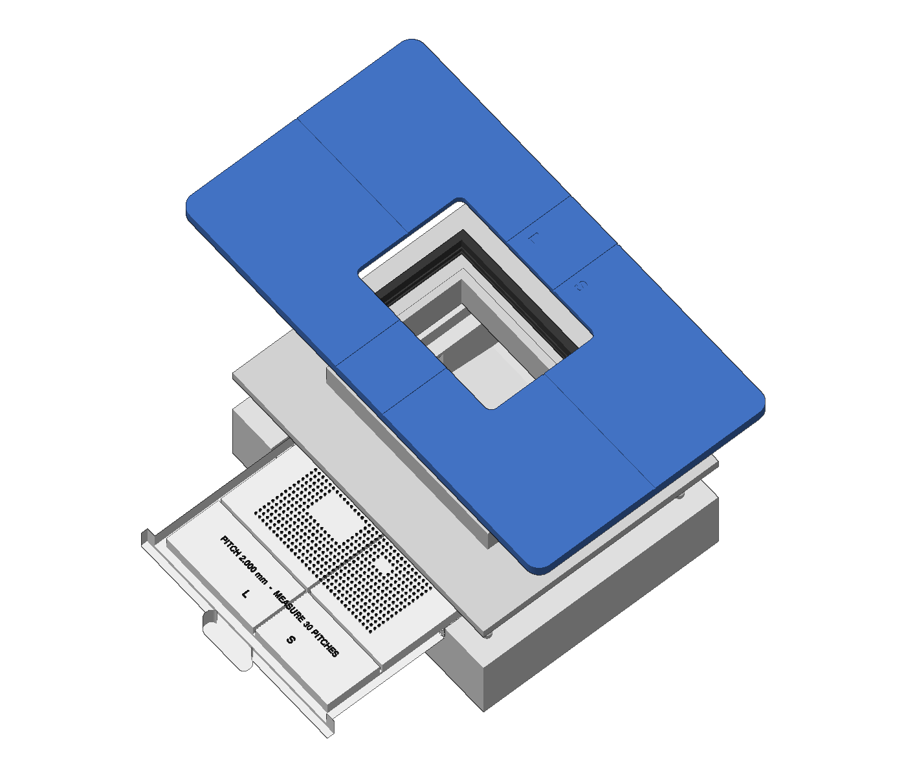

# Particle Field — phone particle sizer, 100–2000 µm

A phone app plus a 3D‑printed stand that measures particle size distributions in the field.
Each photo calibrates itself from a printed dot grid lying in the same plane as the particles. That gives
the scale, corrects tilt and lens distortion, and checks focus, so the phone can sit loosely on the stand.



```
particle-field/
  www/            the app (HTML/JS). Runs as a web app or inside the native wrappers
    core.js       measurement engine (calibration, segmentation, sub-pixel sizing, statistics)
  cad/
    stand.py      parametric CAD source (CadQuery = the OpenCASCADE kernel FreeCAD uses)
    layout.json   calibration grid definition, shared by the CAD and the app
    out/          STEP (open in FreeCAD) + STL + 2-colour 3MF for Bambu Studio
  android/        Capacitor Android project (open in Android Studio)
  scripts/setup-ios.sh   creates and opens the iOS project on a Mac
  test/           synthetic-image accuracy test, browser end-to-end test, sample image
```

---

## 1. How it reaches 5 % at 200 µm

| Error source | How it is handled | Size at 200 µm |
|---|---|---|
| Absolute scale | 2.000 mm dot pitch, **measured on your print** with calipers over 30 pitches (60 mm) and entered in Settings | < 0.1 % |
| Phone tilt, perspective | Homography fitted to every visible dot in each photo | < 0.1 % (fit RMS 1–2 µm in tests) |
| Lens distortion | One radial term fitted per photo | included above |
| Blur, JPEG sharpening, threshold choice | Size comes from *grey-level coverage* in linear light over an edge band, not from a binary outline. Area under a blurred edge is conserved, so blur doesn't bias it | 0.1–0.4 % at σ ≤ 2 px |
| sRGB gamma | Converted to linear light first. Without this, a 50 % threshold under-sizes by about 10 % | — |
| Particle height above the tray | A sphere's outline sits D/2 above the dots. Corrected using the stand height | 0.5 % at 21 mm |
| Resolution | The app needs ≥ 20 px across 200 µm (≤ 10 µm/px) for a green result | — |

**Synthetic test results** (rendered 12 MP phone photos with tilt, distortion, vignetting, optical blur,
phone-style sharpening, noise and sRGB encoding; 54 particles of known size per image):

| Case | 200 µm mean error | 200 µm max error | 100 µm mean error |
|---|---|---|---|
| 8 µm/px, blur σ 1.3 px (phone macro, good focus) | −0.11 % | 0.20 % | +0.08 % |
| 12 µm/px, blur σ 2.0 px (coarse) | +0.21 % | 0.61 % | +0.76 % |
| 10 µm/px, blur σ 3.5 px (badly focused) | −0.37 % | 0.88 % | −1.6 % |
| 3 µm/px, window S (clip-on lens) | −0.02 % | 0.33 % | −0.04 % |

Reproduce: `node test/synth.js <um_per_px> <blur_sigma_px> <seed> <L|S>`.
Real photos will be worse than synthetic ones (print quality, particle shape, uneven light). Validate once
with reference particles (section 6) before you rely on the numbers.

### Which phone setup gives enough resolution

| Setup | Typical scale | Window | Verdict |
|---|---|---|---|
| iPhone 13 Pro or later (auto macro), Androids with a real macro or close-focus ultrawide | 6–10 µm/px | **L** (18 × 12 mm) | meets spec |
| Any phone + clip-on 10–15× macro lens ($10–20) | 2–5 µm/px | **S** (6 × 4 mm) | meets spec easily, but fewer particles per photo |
| Main camera at its closest focus (10–15 cm) | 25–40 µm/px | L | **does not** meet 5 % at 200 µm; fine for > 600 µm |

The **Align camera** live view shows the field width, a predicted µm/px and sharpness before you shoot.

**Coin instead of the printed grid?** I left it out. A coin's diameter is accurate, but its outline sits
1.5–2 mm above the particles. At macro distances (20–40 mm) that alone is a 4–8 % scale error, and one
coin can't correct tilt. The grid is in the particle plane in every photo.

---

## 2. Printing (Bambu Lab P1S, PLA)

| Part | File | Colour | Orientation | Notes |
|---|---|---|---|---|
| Calibration tray | `tray_2color.3mf` (or `tray_white.stl` + `tray_black.stl`) | **White + Black (AMS)** | Top surface **down** on a smooth plate (as exported) | 0.2 mm layers. Set *Elephant foot compensation = 0* and *X-Y contour/hole compensation = 0*. Prime tower on. The first 5 layers carry the dots |
| Base body | `base_body.stl` | White | Floor down | 15 % infill. White inside = bright, even backlight |
| Base lid | `base_lid.stl` | Black preferred | Flat roof down | Drops onto 4 pegs. Lift it off to clean out spilled powder |
| Spacer 10 mm ×1, 20 mm ×2 | `spacer_10.stl`, `spacer_20.stl` | Black | Rim up | Matte black reduces stray reflections |
| Deck | `deck.stl` | Any | Grooves up | |

**If the 3MF doesn't open as one object with two parts:** drag both tray STLs into Bambu Studio together and
answer **Yes** to "load as a single object with multiple parts", then set the dots part to the black filament.
The tray needs an AMS (or AMS lite): the dots and the white diffuser share the same layers, so a
filament change at a layer height can't produce them. The other parts are single-colour.

Optional: 4 × 10 mm silicone bumper feet (recesses are in the base), and a clip-on 10–15× macro lens.

### Calibrate your print (once, 2 minutes)
1. With calipers, measure from the **left edge of one dot to the left edge of the dot 30 places along the same row** (nominal 60.00 mm).
2. Divide by 30 and enter that in **Settings → Tray dot pitch** (e.g. 59.88 mm → 1.9960).
3. Do this along a row (X) and a column (Y). If they differ by more than 0.2 %, enter the mean and check printer flow and belt tension.

---

## 3. Assembly
1. Base body on a flat surface. Lid onto the 4 pegs.
2. Slide the tray (drawer) in, dots up, grip facing you, until the face plate stops.
3. Stack spacers on the lid's rim as needed. The deck goes on top.
4. Phone screen-up on the deck, camera over the aperture. The engraved lines **L** and **S** mark the two window centres.

Phone-back-to-tray distances: no spacer 21 mm, +10 → 31, +20 → 41, +10+20 → 51, +20+20 → 61.
Typical starting points: iPhone Pro macro **+10 (31 mm)**; clip-on lens **no spacer** (adjust to the lens's working distance); then fine-tune with the live view.

---

## 4. Field procedure
1. Pull the drawer out. Sprinkle a small sub-sample thinly over window **L** (or **S**). Tap the tray gently to break up clumps. Aim for particles that mostly don't touch, covering about 10–20 % of the window.
2. Slide the drawer back in.
3. Light from below. **Outdoors**, point the back or side light ports at open sky or the sun. **Indoors**, shine a phone torch or desk lamp into a port. The tunnel blocks light from above, so particles appear as dark silhouettes.
4. In the app: **Take photo** (the native camera opens; tap the window to focus) or **Import photos**.
5. Check the badge on each photo. **Good** means ≥ 20 px per 200 µm, sharp, and a clean grid fit. Tap a photo to see outlines.
6. Repeat with fresh sub-samples until **Results** shows ≥ 500 particles. D10/D50/D90 stabilise around there.
7. **Export** a particle or class CSV (shares to Files, email, etc.), or **Save to history** on the phone.

Settings worth knowing:
- **Size measure**: ECD (default) or Feret min, which is closest to sieve size.
- **By volume** weights by particle volume (≈ mass for one material). It matches sieve and laser results better than **By count**.
- **Edge threshold**: keep *50 %* for opaque particles. Use *Automatic* for translucent ones (glass, salt).
- **Height correction**: on by default (assumes roughly equant particles). Turn it off for flakes and plates.

---

## 5. Building the phone apps

The app is plain HTML/JS in `www/`. You can use it three ways:

**A. Web app (quickest).** Host `www/` on any HTTPS server (GitHub Pages, Netlify, an internal server), open it on the phone,
then *Share → Add to Home Screen* (iOS) or *Install app* (Android Chrome). It works offline after the first load.
Camera capture, import, analysis and export all work in Safari and Chrome. Local test: `npx http-server www`.

**B. Android app.**
```
npm install
npx cap sync android
npx cap open android        # Android Studio → Run, or Build > Generate Signed Bundle for Play
```
Camera and location permissions are already in `AndroidManifest.xml`.

**C. iOS app (Mac with Xcode 16+).**
```
./scripts/setup-ios.sh      # npm install, adds ios/, writes camera/photo/location usage strings, opens Xcode
```
In Xcode, choose your Team under *Signing & Capabilities*, then Run on your iPhone. For TestFlight or the App Store: *Product → Archive*.

After editing anything in `www/`, run `npx cap sync` again.

---

## 6. Validating on real samples (recommended before relying on 5 %)
1. **Scale and geometry:** place a glass **stage micrometer** (1 mm in 0.01 mm divisions, about $10) on window L. Its graduations sit 1 mm above the tray, so it reads about 3 % large at 31 mm. Better: use precision **steel or ruby balls** (grade G10–G25: 0.5, 1.0, 2.0 mm), which sit on the tray like real particles. ECD should read within 1–2 %.
2. **At 200 µm:** use a certified glass-bead size standard (e.g. Whitehouse Scientific, or NIST-traceable soda-lime microspheres around 200 µm). Compare D50 by count to the certificate.
3. Repeat in sunlight and indoors, and at each spacer height you plan to use.

---

## 7. Changing the design
- **Geometry:** edit constants at the top of `cad/stand.py` and run `python3 cad/stand.py` (needs `pip install cadquery`). It rewrites `cad/out/`. Open the STEP files in FreeCAD for viewing, measuring or further modelling.
- **Grid or windows:** edit `cad/layout.json` **and** the `LAYOUT` constant at the top of `www/core.js`. They must match.
- The app finds windows by the pattern of missing dots, so it works whichever way the phone is rotated.

## Known limits
- The size range is set by the window: 2000 µm particles fit window L comfortably but are only about 1/3 of window S's height. Use L for coarse material.
- Touching particles are split by watershed, which works for rounded grains. Heavily agglomerated or fibrous material needs thinner spreading.
- Very translucent particles can be partly missed. Use the *Automatic* threshold and check the outlines.
- 48 MP photos are downscaled to 16 MP (a WebView canvas limit). That's about the true optical resolution of quad-Bayer sensors anyway.
